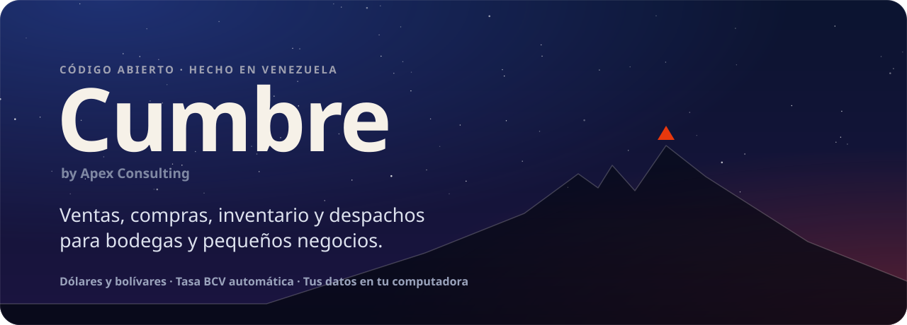
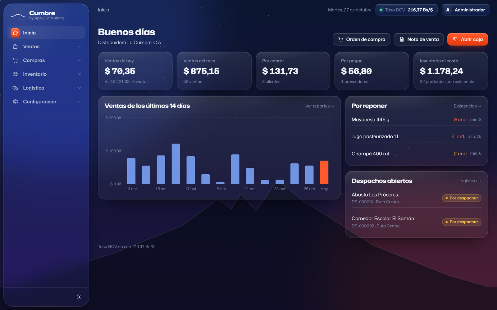
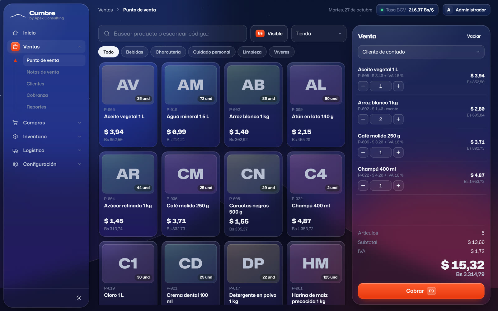
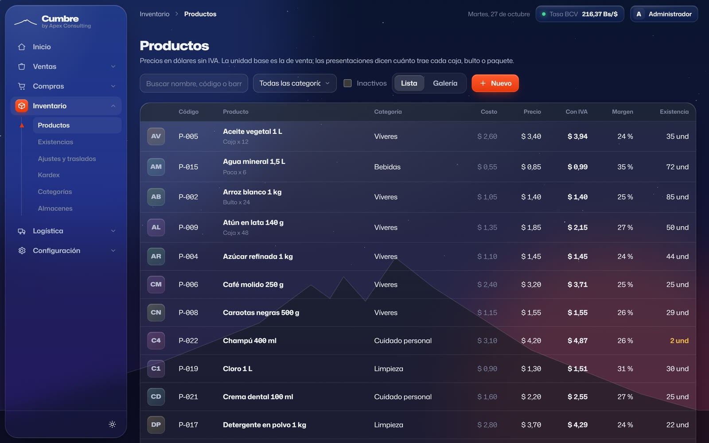
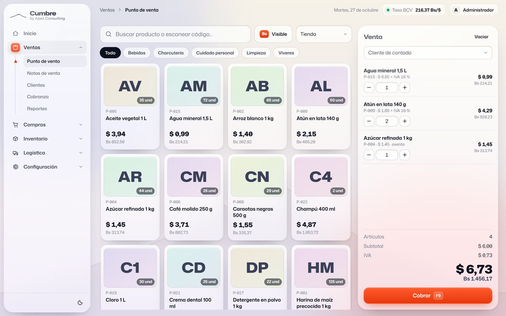
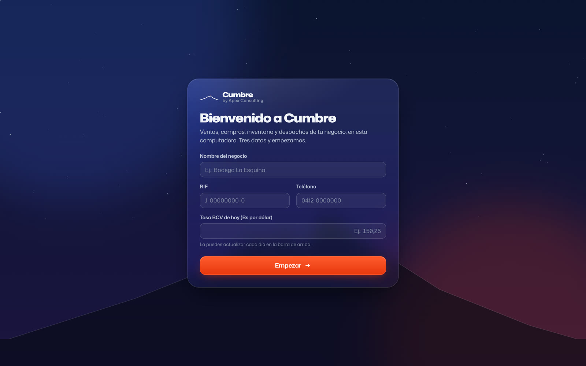

<p align="center">
  
</p>

<p align="center">
  <a href="https://www.apexconsultingve.com/descargas/Cumbre-instalador.exe"></a>
</p>

<p align="center">
  <a href="https://www.apexconsultingve.com/descargas/Cumbre-instalador.exe"></a>
  <a href="LICENSE"></a>
  
  
</p>

<p align="center">
  <b>Gratis, de código abierto y sin activación.</b><br>
  Se instala en un minuto, trabaja sin internet y tu información se queda en tu computadora.
</p>

<p align="center">
  <a href="#qué-es-cumbre">Qué es</a> ·
  <a href="#instalación">Instalación</a> ·
  <a href="#módulos">Módulos</a> ·
  <a href="#para-desarrolladores">Desarrollo</a> ·
  <a href="CONTRIBUTING.md">Contribuir</a>
</p>

<br>

<p align="center">
  
</p>

## Qué es Cumbre

Cumbre es el sistema administrativo de tu bodega, abasto o distribuidora. Vendes en caja, llevas el inventario, le compras a tus proveedores, cobras lo que te deben y despachas los pedidos, todo desde un mismo lugar. Los precios van en dólares y los bolívares salen solos con la tasa BCV del día.

- **Pensado para Venezuela.** Cobro mixto en dólares y bolívares con vuelto; efectivo, pago móvil, punto y Zelle. Cada documento guarda la tasa de su día, así que tus reportes viejos no cambian cuando sube el dólar.
- **Tasa BCV automática.** Cumbre lee la tasa del BCV al abrir y cada 3 horas. Si prefieres, la escribes tú.
- **Tus datos son tuyos.** Todo vive en tu computadora, en una base SQLite. No hay cuentas, mensualidades ni nube obligatoria.
- **Respaldos sin pensarlo.** Hace una copia al abrir y otra cada 12 horas. Si eliges una carpeta de Google Drive o de OneDrive, la copia sube sola a la nube.
- **Compra por caja, vende por unidad.** Las presentaciones (caja, bulto, paquete) convierten cantidades y costos al recibir. También puedes vender al mayor, con su propio precio y código de barras.
- **Cada quien ve lo suyo.** Hay cuatro roles: administrador, gerente, cajero y almacén. Si les pones clave, cada usuario entra con la suya.
- **Con tu marca.** Pones tu logo, tu fondo y tu color, y escoges entre el tema noche y el tema papel.

<table>
  <tr>
    <td width="50%"><p align="center"><sub><b>Punto de venta.</b> Código de barras, fotos y bolívares a la vista.</sub></p></td>
    <td width="50%"><p align="center"><sub><b>Productos.</b> Costos, márgenes, IVA y presentaciones.</sub></p></td>
  </tr>
  <tr>
    <td width="50%"><p align="center"><sub><b>Tema papel.</b> Para cajas con mucha luz.</sub></p></td>
    <td width="50%"><p align="center"><sub><b>Empiezas con tres datos.</b> Los de tu negocio, y a trabajar.</sub></p></td>
  </tr>
</table>

## Instalación

1. **[Descarga el instalador](https://www.apexconsultingve.com/descargas/Cumbre-instalador.exe)** desde apexconsultingve.com.
2. Ábrelo. El instalador todavía no tiene firma digital, así que Windows puede mostrar *«Windows protegió tu PC»*: toca **Más información → Ejecutar de todas formas**.
3. Abre Cumbre, escribe el nombre de tu negocio, el RIF, el teléfono y la tasa del día, y empieza a trabajar.

> [!NOTE]
> Necesitas **Windows 10 u 11 de 64 bits**. Cumbre usa Microsoft Edge WebView2, que ya viene en Windows 11. Si a tu equipo le falta, el instalador te lleva a descargarlo.

Tu información queda en `%APPDATA%\ve.apexconsulting.cumbre\cumbre.db`. Desinstalar Cumbre no la borra.

**¿Vienes de la 0.2?** Instala la nueva encima: conservas toda tu información y ya no hay licencia ni período de prueba.

## Módulos

| Módulo | Qué trae |
|---|---|
| **Ventas** | Punto de venta (código de barras, cobro mixto $/Bs con vuelto), notas de venta (a crédito y con despacho), clientes, cobranza por antigüedad y reportes |
| **Compras** | Órdenes de compra, recepciones (parciales, a costo promedio), proveedores y cuentas por pagar |
| **Inventario** | Productos con foto, código y presentaciones, existencias por almacén, ajustes, conteo físico, traslados, kardex, categorías y almacenes |
| **Logística** | Tablero de despachos, rutas y transportistas |
| **Configuración** | Empresa, personalización, tasa BCV, impuestos, métodos de pago, numeración, usuarios y respaldos |

> [!IMPORTANT]
> Cumbre emite documentos **no fiscales** (tickets y notas de entrega). No sustituye a la máquina fiscal ni a un proveedor autorizado por el SENIAT.

## Para desarrolladores

### Cómo está hecho

| Capa | Tecnología |
|---|---|
| Interfaz | [Svelte 5](https://svelte.dev) + Vite + TypeScript, con el sistema visual de Apex: vidrio líquido, azul noche, rojo señal, papel y Mona Sans |
| Escritorio | [Tauri 2](https://tauri.app) (Rust), con ventana Mica en Windows 11 |
| Datos | SQLite. En el escritorio lo ejecuta Rust (`rusqlite`). En el navegador corre sobre sql.js (WebAssembly) y se guarda en IndexedDB, para desarrollar y hacer demos |
| Lógica | `src/lib/servicios/`. Cada operación (una venta, una recepción…) va a la base como una sola transacción: entra completa o no entra |

```
src/
├─ lib/servicios/     lógica de negocio (ventas, compras, inventario…)
├─ lib/db/            esquema y los dos motores: escritorio y navegador
├─ lib/marco/         barra lateral, barra superior, bienvenida, entrada
├─ paginas/           pantallas por módulo
└─ app.css            sistema visual
src-tauri/src/
├─ db.rs              SQLite en el escritorio
├─ bcv.rs             lectura de la tasa BCV
└─ respaldo.rs        respaldos automáticos
instalador/           script de NSIS
tests/                pruebas de los cálculos
```

### Arrancar

Necesitas [Node.js](https://nodejs.org) 22.18 o más nuevo. Para la app de escritorio también necesitas [Rust](https://rustup.rs) y los [requisitos de Tauri para Windows](https://tauri.app/start/prerequisites/).

```bash
git clone https://github.com/edev-max/cumbre.git
cd cumbre
npm install
npm run dev          # Cumbre en el navegador, sin instalar nada: http://localhost:1420
npm run tauri dev    # Cumbre como aplicación de escritorio
npm test             # pruebas de cálculos
npm run check        # tipos
```

### Armar el instalador

| Desde | Comando | Resultado |
|---|---|---|
| Windows | `npm run tauri build` | `src-tauri/target/release/bundle/nsis/` |
| Linux o WSL (con `mingw-w64`, `nsis` y el target `x86_64-pc-windows-gnu`) | `npm run instalador` | `instalador/Cumbre-<versión>-instalador.exe` |
| GitHub Actions | *Run workflow* o etiqueta `v*` | el instalador, en los *Artifacts* de la ejecución |

El botón de descarga de este README apunta a `https://www.apexconsultingve.com/descargas/Cumbre-instalador.exe`. Los pasos para publicar una versión están en [CONTRIBUTING.md](CONTRIBUTING.md#publicar-una-versión).

## Contribuir

Puedes reportar errores, proponer ideas y mandar cambios. Abre un [issue](https://github.com/edev-max/cumbre/issues) o un pull request. Antes, lee [CONTRIBUTING.md](CONTRIBUTING.md): ahí están las convenciones del proyecto (montos en centavos, textos en español de Venezuela, la marca) y cómo comprobar tus cambios.

## Lo que viene

- Integración con máquina fiscal o con un proveedor autorizado por el SENIAT.

## Licencia

Cumbre es software libre bajo la [licencia MIT](LICENSE): puedes usarlo, modificarlo y compartirlo, también con fines comerciales.

<br>

<p align="center">
  <sub>Hecho en Venezuela por <b>Apex Consulting</b></sub>
</p>
